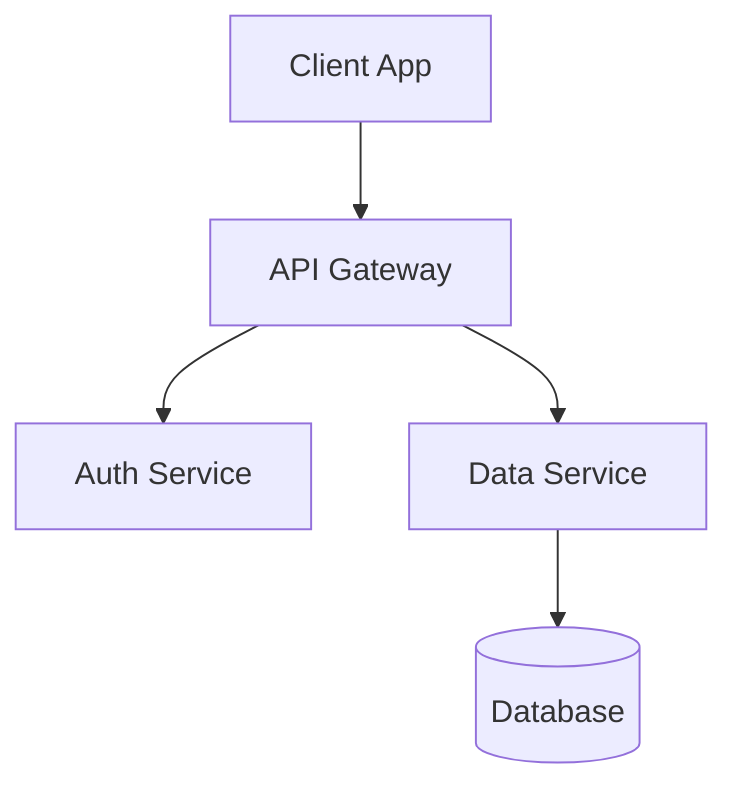

# Persian-md2pdf (تبدیل مارک‌داون فارسی و انگلیسی به پی‌دی‌اف)

[](https://opensource.org/licenses/MIT)
[](https://www.python.org/)
[](#)
[](#)
[](#)

> **A professional, open-source tool and Python library to convert Persian (RTL) and English (LTR) Markdown files into publication-quality, beautiful PDF documents.**
> Complete with **Mermaid vector diagrams**, **LaTeX math formulas (KaTeX)**, code syntax blocks, styled tables, GitHub callouts, and clean pagination.

[🇮🇷 مستندات فارسی (Persian Documentation)](README_FA.md)

---

## ✨ Features

- **Bilingual Layout (Persian RTL & English LTR)**:
  - **Persian mode (default)**: Right-to-Left text direction with balanced line spacing, text justification, and the beautiful Google **Vazirmatn** font (with Shabnam, Sahel, B Nazanin fallbacks).
  - **English mode (`--english`)**: Full Left-to-Right layout, modern **Inter** font stack, left-aligned headings, left-border accents, and English page numbering (`Page 1`).
- **Mermaid Vector Diagrams**:
  - Automatically compiles standard markdown ````mermaid ... ```` blocks into crisp, vector SVG diagrams embedded directly into the PDF.
  - Supports flowcharts, sequence diagrams, class diagrams, state diagrams, and entity-relationship diagrams in both Persian and English documents.
- **Bidirectional Text Isolation**: English terms, acronyms, and technical phrases inside Persian sentences render without corrupted punctuation or flipped parenthesis.
- **LaTeX Math Rendering (KaTeX)**:
  - Inline formulas: `$E = mc^2$`
  - Display equations: `$$\int_{-\infty}^{\infty} e^{-x^2} dx = \sqrt{\pi}$$`
  - All mathematical equations are automatically isolated into LTR so formulas and matrices never get mangled in RTL mode.
- **Code Block Formatting**: Monospace code blocks with clean LTR alignment, dark or academic styling, and terminal looks.
- **GitHub-style Callouts / Admonitions**: Beautiful styled alert boxes for `> [!NOTE]`, `> [!TIP]`, `> [!IMPORTANT]`, `> [!WARNING]`, and `> [!CAUTION]`, with English labels in English mode and localized Persian labels in Persian mode.
- **Multiple Built-in Themes**:
  - `modern`: Clean contemporary design with blue accents and crisp typography.
  - `academic`: Formal design optimized for theses, university reports, and scientific papers.
  - `minimal`: Sleek monochrome layout with high contrast.
  - `github`: Familiar GitHub documentation layout adapted for RTL & LTR.
- **Persian Digits Converter**: Optional conversion of Western digits (`0-9`) into Persian digits (`۰-۹`) via `--persian-numbers` while safely protecting code blocks, math, diagrams, and HTML tags.
- **CSS Paged Media**: Automatic page numbering (`صفحه ۱` / `Page 1`), headers, footers, and customizable page sizes (`A4`, `Letter`) and margins.
- **Zero Binary Setup**: Uses headless Chromium / Microsoft Edge / Google Chrome / Brave already installed on your machine. No bulky Cairo/Pango or wkhtmltopdf binaries required!
- **Live Watch Mode (`--watch`)**: Automatically detects file modifications and recompiles to PDF upon saving.
- **Batch Processing**: Convert single files, glob patterns, or entire directories with one command.

---

## 🚀 Installation

### From GitHub:
```bash
git clone https://github.com/TeleEng/Persian-md2pdf.git
cd Persian-md2pdf
pip install .
```

### For Development (Editable Mode):
```bash
pip install -e .
```

---

## 🛠️ Command-Line Interface (CLI)

Once installed, the `persian-md2pdf` command is available everywhere in your terminal:

```bash
# Basic Persian conversion (creates document.pdf)
persian-md2pdf document.md

# English mode (LTR layout with Inter font and English callouts)
persian-md2pdf architecture.md --english

# Specify custom output path
persian-md2pdf document.md -o output.pdf

# Choose a theme (modern, academic, minimal, github)
persian-md2pdf thesis.md -o thesis.pdf --theme academic

# Convert numbers in Persian prose to Persian digits (۰-۹)
persian-md2pdf report.md --persian-numbers

# Watch mode for live editing (recompiles on save)
persian-md2pdf report.md --watch
persian-md2pdf report.md --english --watch

# Convert an entire folder of markdown documents
persian-md2pdf ./docs/ -o ./dist/ --english

# Export as HTML only
persian-md2pdf guide.md -o guide.html --html-only

# Apply custom CSS
persian-md2pdf report.md --css custom_style.css
```

### CLI Options Reference

| Option | Short | Description | Default |
| :--- | :---: | :--- | :--- |
| `input` | | Path to Markdown file(s) or directory | Required |
| `--output` | `-o` | Output PDF file or directory | Input name with `.pdf` |
| `--english` / `--English` | `-en` | Enable English LTR mode | `False` (Persian RTL) |
| `--theme` | `-t` | Visual theme (`modern`, `academic`, `minimal`, `github`) | `modern` |
| `--font` | `-f` | Primary font family | `Vazirmatn` (fa) / `Inter` (en) |
| `--page-size` | | Page size (`A4`, `Letter`, etc.) | `A4` |
| `--margins` | | Page margins (`top right bottom left`) | `20mm 15mm 20mm 15mm` |
| `--no-mermaid` | | Disable Mermaid diagram rendering | `False` (Mermaid enabled) |
| `--no-katex` | | Disable KaTeX math parsing | `False` (KaTeX enabled) |
| `--persian-numbers` | | Convert digits 0-9 to Persian digits ۰-۹ | `False` |
| `--html-only` | | Generate only HTML output | `False` |
| `--keep-html` | | Keep intermediate HTML file next to PDF | `False` |
| `--css` | | Path to custom CSS file or stylesheet | `None` |
| `--browser` | | Custom path to Chrome/Edge executable | Auto-detected |
| `--watch` | `-w` | Watch for file modifications and recompile | `False` |
| `--version` | `-v` | Show installed version | |

---

## 🐍 Python API Usage

You can easily integrate `persian-md2pdf` into your Python scripts, web servers, or data pipelines:

```python
from persian_md2pdf import md2pdf, md2html

# Simple Persian conversion
pdf_path = md2pdf("report.md", "report.pdf")

# English conversion with Mermaid and modern theme
pdf_path = md2pdf(
    input_file="architecture.md",
    output_pdf="architecture.pdf",
    english=True,
    theme="modern",
)

# Customized Persian conversion
pdf_path = md2pdf(
    input_file="thesis.md",
    output_pdf="thesis.pdf",
    theme="academic",
    font="Vazirmatn",
    page_size="A4",
    persian_numbers=True,
    katex=True,
    mermaid=True,
)

# Convert raw Markdown string to standalone HTML
html_content = md2html(
    input_source="# System Architecture\n```mermaid\ngraph TD\nA-->B\n```",
    english=True,
    theme="modern",
)
```

---

## 📊 Mermaid Diagrams Example

````markdown

````

Diagrams are rendered into vector SVG elements centered and scaled to fit the printable area.

---

## 🎨 Themes Showcase

| Theme | Best For | Description |
| :--- | :--- | :--- |
| **`modern`** | Reports & Portfolios | Contemporary blue accents, subtle shadows, clean typography. |
| **`academic`** | Theses & Research Papers | Formal book styling, structured headers, traditional borders. |
| **`minimal`** | Documentation & Handouts | Distraction-free monochrome typography with high contrast. |
| **`github`** | Technical Guides | Authentic GitHub Markdown appearance adapted for RTL & LTR. |

---

## 🌐 Supported Browsers

`persian-md2pdf` detects installed Chromium-based browsers automatically:
- **Windows**: Microsoft Edge, Google Chrome, Brave, Chromium
- **Linux**: Google Chrome, Chromium, Microsoft Edge, Brave
- **macOS**: Google Chrome, Microsoft Edge, Brave, Chromium

You can also specify a custom path using `--browser /path/to/browser` or by setting the `BROWSER_PATH` / `CHROME_BIN` environment variable.

---

## 🧪 Testing

Run the included test suite with:

```bash
python -m unittest discover tests -v
```

---

## 📄 License

This project is licensed under the [MIT License](LICENSE). Contributions, bug reports, and feature requests are welcome!
