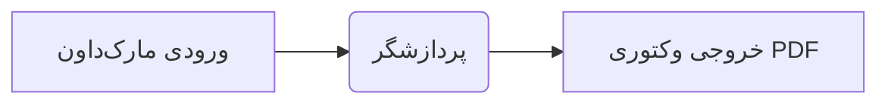

# ابزار تبدیل مارک‌داون فارسی و انگلیسی به پی‌دی‌اف (Persian-md2pdf)

[](https://opensource.org/licenses/MIT)
[](https://www.python.org/)
[](#)
[](#)
[](#)

> **یک ابزار و کتابخانه حرفه‌ای و متن‌باز پایتون برای تبدیل اسناد مارک‌داون (Markdown) به فایل‌های پی‌دی‌اف (PDF) شکیل با استانداردهای نشر بین‌المللی.**
> دارای پشتیبانی دوگانه از متون **فارسی (راست‌چین RTL)** و **انگلیسی (چپ‌چین LTR)**، **نمودارهای وکتوری Mermaid**، فرمول‌های ریاضی لاتک (KaTeX)، بلوک‌های کد برنامه‌نویسی، جدول‌ها، کادرهای اعلان گیت‌هاب (Admonitions) و صفحه‌بندی هوشمند.

---

## 🌟 ویژگی‌های برجسته

۱. **پشتیبانی دوگانه از فارسی و انگلیسی (RTL & LTR)**:
   - **حالت فارسی (پیش‌فرض)**: چیدمان کاملاً راست‌چین با فونت استاندارد **وزیرمتن (Vazirmatn)** از گوگل فونت، تراز متن تمیز و شماره صفحه فارسی (`صفحه ۱`).
   - **حالت انگلیسی (`--english`)**: چیدمان چپ‌به‌راست (LTR)، قلم مدرن **Inter**، بردرهای شاخص سمت چپ، شماره‌گذاری انگلیسی (`Page 1`) و عناوین انگلیسی برای کادرها.

۲. **رندر نمودارهای وکتوری مرساد (Mermaid Diagrams)**:
   - پشتیبانی از انواع نمودارها (فلوچارت، دیاگرام توالی Sequence، نمودار کلاس و وضعیت) که در بلاک‌های ```` ```mermaid ```` نوشته می‌شوند.
   - نمودارها به صورت مستقیم و برداری (SVG) بدون افت کیفیت درون سند PDF کامپایل می‌شوند.

۳. **تفکیک هوشمند جهت متن‌های ترکیبی (Bidi Isolation)**:
   - واژگان انگلیسی، عبارات تخصصی و پرانتزها در میان جملات فارسی دچار به‌هم‌ریختگی یا جابه‌جایی نمی‌شوند.

۴. **رندر فرمول‌های ریاضی و نمادهای لاتک (KaTeX)**:
   - پشتیبانی از فرمول‌های درون‌خطی (`$E = mc^2$`) و فرمول‌های بلوکی چندخطی (`$$ ... $$`).
   - فرمول‌ها به طور خودکار در جهت چپ‌به‌راست (LTR) ایزوله می‌شوند تا جهت کسرها، ماتریس‌ها و نمادهای ریاضی به هم نخورد.

۵. **کادرهای اعلان و هشدار گیت‌هاب (Callouts)**:
   - پشتیبانی از `> [!NOTE]`، `> [!TIP]`، `> [!IMPORTANT]`، `> [!WARNING]` و `> [!CAUTION]`.
   - امکان استفاده از نام‌های فارسی نظیر `> [!نکته]`، `> [!هشدار]`، `> [!مهم]`، `> [!احتیاط]`.

۶. **قالب‌های ظاهری متنوع (Themes)**:
   - `modern`: قالب مدرن با تم رنگی آبی نیلی، مناسب گزارش‌ها و مستندات شرکتی.
   - `academic`: قالب رسمی دانشگاهی با چیدمان استاندارد کتاب و پایان‌نامه.
   - `minimal`: قالب مینیمال سیاه‌وسفید و خلوت با حداکثر کنتراست.
   - `github`: سبک ظاهری مستندات رسمی گیت‌هاب منطبق بر زبان فارسی و انگلیسی.

۷. **تبدیل ارقام به فارسی (`--persian-numbers`)**:
   - قابلیت تبدیل خودکار اعداد انگلیسی (0-9) به فارسی (۰-۹) در متن گزارش، در حالی که کدها، نمودارها، فرمول‌های ریاضی و تگ‌های HTML دست‌نخورده باقی می‌مانند.

۸. **حالت نظارت زنده (`--watch`)**:
   - نظارت خودکار بر فایل در حین نگارش؛ به محض فشردن کلید Ctrl+S در ویرایشگر شما (VSCode و ...)، فایل PDF بلافاصله کامپایل مجدد می‌شود.

---

## 📥 نصب و راه‌اندازی

### نصب از گیت‌هاب:
```bash
git clone https://github.com/TeleEng/Persian-md2pdf.git
cd Persian-md2pdf
pip install .
```

### نصب در حالت توسعه (Editable):
```bash
pip install -e .
```

---

## 🖥️ راهنمای دستور خط فرمان (CLI)

پس از نصب، دستور `persian-md2pdf` در هر کجای ترمینال یا خط فرمان در دسترس خواهد بود:

```bash
# تبدیل ساده فایل فارسی به PDF
persian-md2pdf document.md

# تبدیل سند انگلیسی با چیدمان LTR و فونت Inter
persian-md2pdf architecture.md --english

# مشخص کردن مسیر فایل خروجی
persian-md2pdf document.md -o output.pdf

# انتخاب قالب دانشگاهی برای پایان‌نامه و مقالات
persian-md2pdf thesis.md -o thesis.pdf --theme academic

# تبدیل اعداد لاتین متن به ارقام فارسی
persian-md2pdf report.md --persian-numbers

# فعال‌سازی حالت ویرایش و نظارت زنده (کامپایل خودکار با هر ذخیره)
persian-md2pdf report.md --watch
persian-md2pdf doc.md --english --watch

# تبدیل دسته‌جمعی تمامی فایل‌های مارک‌داون یک پوشه
persian-md2pdf ./docs/ -o ./output/ --english
```

### جدول سوییچ‌ها و تنظیمات خط فرمان

| سوییچ | مخفف | شرح کارکرد | مقدار پیش‌فرض |
| :--- | :---: | :--- | :--- |
| `input` | | مسیر فایل یا پوشه مارک‌داون ورودی | اجباری |
| `--output` | `-o` | مسیر فایل پی‌دی‌اف یا پوشه خروجی | نام فایل با پسوند `.pdf` |
| `--english` / `--English` | `-en` | فعال‌سازی حالت انگلیسی چپ‌به‌راست (LTR) | `غیرفعال` (فارسی RTL) |
| `--theme` | `-t` | قالب ظاهری (`modern`, `academic`, `minimal`, `github`) | `modern` |
| `--font` | `-f` | نام فونت اصلی متن | `Vazirmatn` (fa) / `Inter` (en) |
| `--page-size` | | ابعاد کاغذ (`A4`, `Letter` و ...) | `A4` |
| `--margins` | | فواصل حاشیه صفحه (بالا راست پایین چپ) | `20mm 15mm 20mm 15mm` |
| `--no-mermaid` | | غیرفعال‌سازی پردازش نمودارهای Mermaid | `غیرفعال` (Mermaid فعال) |
| `--mermaid-font-size` | | تنظیم اندازه قلم متن نمودارها (مانند `10px`, `11px`, `9pt`) | `11.5px` (انگلیسی) / `12px` (فارسی) |
| `--mermaid-font` | | نام فونت اختصاصی نمودارها (مانند `Fira Code`, `Tahoma`) | فونت اصلی متن |
| `--mermaid-theme` | | قالب ظاهری نمودارهای Mermaid (`default`, `neutral`, `forest`, `dark`, `base`) | `default` |
| `--no-katex` | | غیرفعال‌سازی پردازش فرمول‌های ریاضی | `غیرفعال` (KaTeX فعال) |
| `--persian-numbers` | | تبدیل اعداد 0 تا 9 متن به ارقام فارسی ۰ تا ۹ | `غیرفعال` |
| `--html-only` | | تولید خروجی HTML بدون ساخت PDF | `غیرفعال` |
| `--keep-html` | | حفظ فایل موقت HTML در کنار PDF خروجی | `غیرفعال` |
| `--css` | | مسیر فایل CSS اختصاصی کاربر | `ندارد` |
| `--browser` | | مسیر دستی فایل اجرایی مرورگر | تشخیص خودکار |
| `--watch` | `-w` | نظارت بر تغییرات فایل و کامپایل لحظه‌ای | `غیرفعال` |
| `--version` | `-v` | نمایش نسخه برنامه | |

---

## 🐍 استفاده در کدهای پایتون (Python API)

```python
from persian_md2pdf import md2pdf, md2html

# تبدیل سند فارسی
md2pdf("report.md", "report.pdf", theme="academic")

# تبدیل سند انگلیسی با نمودار و فرمول ریاضی
md2pdf("system_architecture.md", "system_architecture.pdf", english=True, theme="modern")

# ساخت خروجی HTML برای وب
html_output = md2html(
    input_source="# Architecture\n```mermaid\ngraph LR\nA-->B\n```",
    english=True,
    theme="modern",
)
```

---

## 📊 نمونه نمودار مرساد (Mermaid)

````markdown

````

نمودارها به صورت هوشمند در هر دو حالت متون فارسی و انگلیسی تراز و وسط‌چین می‌شوند.

---

## 🧪 اجرای آزمون‌ها (Tests)

```bash
python -m unittest discover tests -v
```

---

## 📜 پروانه نرم‌افزار

این پروژه تحت پروانه [MIT License](LICENSE) منتشر شده است و استفاده از آن برای اهداف شخصی، دانشگاهی و تجاری آزاد است.
