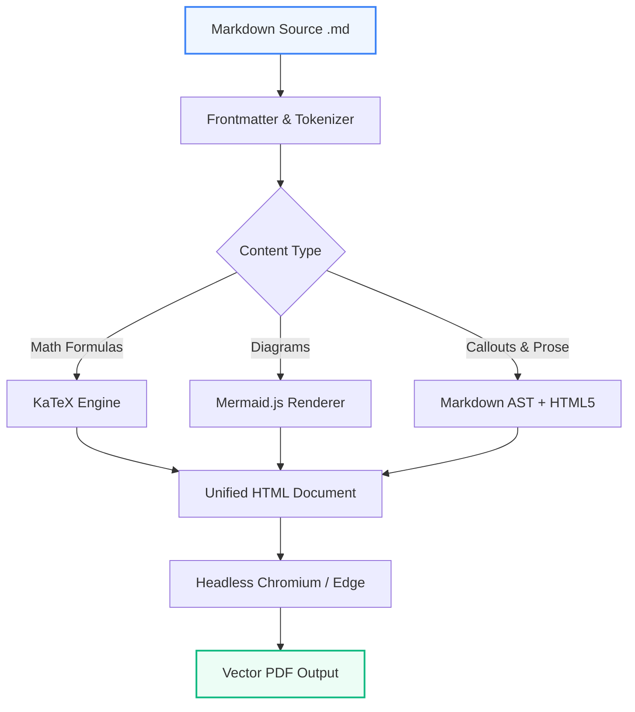
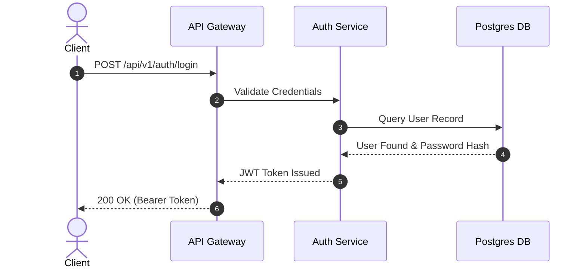

# System Architecture & Performance Benchmark Report

This document showcases the full capabilities of **persian-md2pdf** when running in English mode via the `--english` flag. It provides native Left-to-Right (LTR) typography, vector Mermaid diagram rendering, KaTeX mathematical formulas, GitHub-style callouts, and clean pagination.

---

## 1. Executive Summary

Documenting software systems, algorithms, and technical designs requires seamless integration of prose, mathematical formulations, and visual architectural diagrams. 

> [!NOTE]
> When compiled with `--english`, the layout automatically switches to Left-to-Right (LTR), with modern typography (Inter), left-accented headings, and English page counters (`Page X`).

> [!TIP]
> Use `--watch` during active writing to automatically rebuild the PDF document each time you save in your favorite code editor.

---

## 2. System Architecture & Workflows (Mermaid Diagrams)

Diagrams defined in standard Markdown fenced code blocks (```` ```mermaid ````) are compiled into high-resolution, vector SVG graphics embedded directly into the PDF.

### 2.1. End-to-End Processing Pipeline



### 2.2. User Authentication & Request Lifecycle



---

## 3. Mathematical Foundations (KaTeX)

Mathematical equations are rendered using the KaTeX engine. Inline math such as Euler's formula $e^{i\pi} + 1 = 0$ and the famous mass-energy equivalence $E = mc^2$ align naturally with paragraph text.

### 3.1. Multiline Display Math

The continuous Gaussian normal probability density function is formulated as:

$$f(x \mid \mu, \sigma^2) = \frac{1}{\sigma \sqrt{2\pi}} \exp\left( -\frac{(x - \mu)^2}{2\sigma^2} \right)$$

In multi-dimensional feature space, the covariance matrix $\mathbf{\Sigma}$ and eigenvector decomposition are represented as:

$$\mathbf{\Sigma} = \frac{1}{N} \sum_{i=1}^N (\mathbf{x}_i - \mathbf{\mu})(\mathbf{x}_i - \mathbf{\mu})^T = \mathbf{V} \mathbf{\Lambda} \mathbf{V}^T$$

---

## 4. Benchmark Results & Comparative Analysis

Tables are formatted with modern borders, subtle header backgrounds, and alternating zebra stripes:

| Model Identifier | Architecture | Parameter Count | Latency (ms) | Accuracy (%) | Evaluation Status |
| :--- | :---: | :---: | :---: | :---: | :---: |
| **ResNet-50 v2** | CNN | 25.6 M | 12.4 | 94.8% | Baseline |
| **Transformer-XL** | Self-Attention | 110.0 M | 34.2 | 96.5% | Passed |
| **MobileNet-V3** | Depthwise Conv | 5.4 M | 4.1 | 89.2% | Reviewed |
| **Our Hybrid Model** | Conv-Transformer | 32.1 M | 14.8 | **98.4%** | **Optimal** |

---

## 5. Implementation Code

Fenced code blocks are isolated into monospace formatting with dark terminal themes:

```python
import numpy as np

def compute_covariance_spectrum(features: np.ndarray) -> tuple[np.ndarray, np.ndarray]:
    """Compute eigenvalues and eigenvectors for sample covariance."""
    centered = features - np.mean(features, axis=0)
    cov = np.cov(centered, rowvar=False)
    evals, evecs = np.linalg.eigh(cov)
    # Sort in descending order
    sorted_indices = np.argsort(evals)[::-1]
    return evals[sorted_indices], evecs[:, sorted_indices]
```

To run the converter via command line:

```bash
# Convert in English mode with modern theme
persian-md2pdf sample_report_en.md -o output.pdf --english --theme modern

# Watch mode for live re-compilation
persian-md2pdf sample_report_en.md --english --watch
```

---

## 6. Admonition Callouts

> [!IMPORTANT]
> The `--english` flag switches all borders, paddings, list indentations, and table headers to standard LTR layout.

> [!WARNING]
> Ensure Microsoft Edge, Google Chrome, or Brave is installed on your host machine to allow headless PDF printing.

> [!CAUTION]
> Avoid modifying input Markdown files directly while an automated deployment script is reading them.

---

## 7. Conclusion

By combining **RTL Persian** and **LTR English** document generation with **KaTeX** and **Mermaid**, `persian-md2pdf` provides a versatile, single-dependency solution for generating publication-quality documentation across engineering and scientific disciplines.
