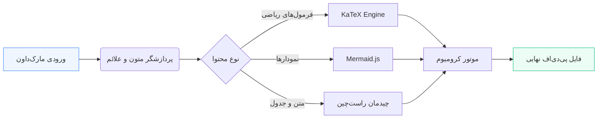

# گزارش جامع مدل‌سازی و تحلیل سیستم‌های هوشمند

این سند به عنوان نمونه‌ای جامع برای ارزیابی قابلیت‌های ابزار **persian-md2pdf** آماده شده است. این ابزار امکان تبدیل فایل‌های متنی مارک‌داون (Markdown) به فایل‌های پی‌دی‌اف (PDF) شکیل، راست‌چین (RTL) و با استانداردهای نشر بین‌المللی را فراهم می‌کند.

---

## ۱. مقدمه و بیان مسئله

در پردازش متون زبان فارسی و زبان‌های با رسم‌الخط راست به چپ (RTL)، چالش‌های متعددی در نمایش صحیح متون ترکیبی (فارسی و انگلیسی)، فرمول‌های ریاضی و بلوک‌های کد وجود دارد. این کتابخانه با بهره‌گیری از موتور چیدمان کرومیوم (Chromium Rendering Engine) و فونت استاندارد **وزیرمتن (Vazirmatn)**، این مشکلات را به طور کامل حل کرده است.

> [!NOTE]
> تمامی سبک‌های صفحه، حاشیه‌ها و شماره‌گذاری صفحات به صورت خودکار بر پایه استانداردهای CSS Paged Media تنظیم می‌شوند.

> [!TIP]
> با استفاده از سوئیچ `--watch`، برنامه به صورت زنده بر ذخیره‌سازی فایل شما نظارت کرده و بلافاصله نسخه PDF را به‌روزرسانی می‌کند.

---

## ۲. فرمول‌های ریاضی و نمادگذاری لاتک (KaTeX)

یکی از وجوه تمایز این ابزار، تفکیک دقیق جهت‌گیری متن و فرمول‌هاست. تمامی فرمول‌های ریاضی در جهت چپ‌به‌راست (LTR) نمایش می‌یابند تا نظم عبارات جبری بر هم نخورد.

### ۲.۱. فرمول درون‌خطی (Inline Math)
رابطه جرم و انرژی اینشتین به صورت $E = mc^2$ بیان می‌شود. همچنین تبدیل فوریه پیوسته برای تابع $f(t)$ به صورت $F(\omega) = \int_{-\infty}^{\infty} f(t) e^{-j\omega t} dt$ تعریف می‌گردد.

### ۲.۲. فرمول بلوکی (Display Math)
تابع چگالی احتمال توزیع نرمال استاندارد گوسی با میانگین $\mu$ و واریانس $\sigma^2$ برابر است با:

$$f(x \mid \mu, \sigma^2) = \frac{1}{\sigma \sqrt{2\pi}} \exp\left( -\frac{(x - \mu)^2}{2\sigma^2} \right)$$

همچنین در مدل‌سازی ماتریسی شبکه‌های عصبی داریم:

$$\mathbf{y} = \sigma\left( \mathbf{W} \cdot \mathbf{x} + \mathbf{b} \right) = \begin{bmatrix} w_{11} & w_{12} \\ w_{21} & w_{22} \end{bmatrix} \begin{bmatrix} x_1 \\ x_2 \end{bmatrix} + \begin{bmatrix} b_1 \\ b_2 \end{bmatrix}$$

---

## ۳. نمودار معماری سیستم (Mermaid Diagrams)

نمودارها و فلوچارت‌های فنی با سینتکس Mermaid مستقیماً به گرافیک‌های برداری وکتوری (SVG) با وضوح بالا تبدیل می‌شوند:



---

## ۴. جدول نتایج و ارزیابی عملکرد

جداول به گونه‌ای طراحی شده‌اند که تیترها با زمینه ملایم و ردیف‌ها به شکل یک‌درمیان (Zebra Stripe) برای خوانایی بهینه در چاپ رنگی و سیاه‌سفید آماده باشند:

| شناسه آزمایش | نام مدل الگوریتم | دقت تشخیصی (Accuracy) | زمان آموزش (ثانیه) | وضعیت نهایی |
| :---: | :--- | :---: | :---: | :---: |
| ۰۱ | ResNet-50 v2 | ۹۴.۸٪ | ۴۲۰ | تایید شده |
| ۰۲ | Transformer-XL | ۹۶.۲٪ | ۶۸۰ | تایید شده |
| ۰۳ | MobileNetV3 | ۸۹.۵٪ | ۱۱۰ | بازبینی |
| ۰۴ | Proposed Method | ۹۸.۱٪ | ۲۹۰ | بهینه |

---

## ۵. قطعه کدهای برنامه‌نویسی (Code Snippets)

کدها در بلوک‌های تمیز با قلم مونو و جهت چپ‌به‌راست (LTR) ایزوله می‌شوند:

```python
# تابع محاسبه ماتریس کوواریانس و مقادیر ویژه
import numpy as np

def compute_eigenvectors(data_matrix: np.ndarray):
    cov_matrix = np.cov(data_matrix, rowvar=False)
    eigenvalues, eigenvectors = np.linalg.eigh(cov_matrix)
    # مرتب‌سازی به صورت نزولی
    idx = np.argsort(eigenvalues)[::-1]
    return eigenvalues[idx], eigenvectors[:, idx]
```

نحوه استفاده سریع از دستور خط فرمان:

```bash
# نصب بسته به همراه دستور اجرایی
pip install persian-md2pdf

# تبدیل سند به PDF با قالب دانشگاهی
persian-md2pdf sample_report_fa.md -o output.pdf --theme academic
```

---

## ۶. انواع جعبه‌های پیام و هشدار (Admonitions)

> [!IMPORTANT]
> برای چاپ کتاب یا پایان‌نامه، قالب `academic` پیشنهاد می‌شود که خطوط و استانداردهای رسمی نگارش دانشگاهی را رعایت می‌کند.

> [!WARNING]
> اطمینان حاصل کنید که یکی از مرورگرهای بر پایه کرومیوم نظیر Google Chrome، Microsoft Edge یا Brave روی سیستم شما نصب باشد.

> [!CAUTION]
> از بستن ترمینال در زمان اجرای دستور `--watch` خودداری کنید تا فرایند پایش تغییرات متوقف نشود.

---

## ۷. نتیجه‌گیری

با استفاده از این ابزار متن‌باز، تولید مستندات فنی، گزارش‌های علمی، اسلایدهای دانلودی و پایان‌نامه‌های فارسی با نگارش Markdown و خروجی باکیفیت وکتوری PDF بسیار ساده و لذت‌بخش شده است.
